<div align="center">

<picture>
  <source media="(prefers-color-scheme: dark)" srcset=".github/assets/banner-dark.svg">
  
</picture>

**Native Lottie (Bodymovin) animations for PAM Native, the equivalent of lottie-react-native.**<br>
lottie-android 6.6 and lottie-ios 4.5 behind one host view, `lottie.view`, driven from PHP or a template tag.

[](https://packagist.org/packages/pushinbr/pam-native-lottie)
[](https://github.com/push-in/pam-native-lottie/releases/latest)

[](LICENSE)

[Install](#install) · [Quick example](#quick-example) · [Platforms](#platform-support) · [Resources](#resource-rules) · [Docs](#docs) · [Issues](https://github.com/push-in/pam-native-lottie/issues)

</div>

<a id="install"></a>
## <picture></picture> Install

Inside a PAM Native project, add only this capability:

```sh
pam composer require pushinbr/pam-native-lottie
pam doctor --fix
```

The plugin registers the `<Lottie>` template tag and the `lottie.view` native view. New to PAM? Create a project with `pam init my-app --template native` (see the [PAM Native overview](https://push-in.github.io/pam-docs/native/overview/)).

<a id="quick-example"></a>
## <picture></picture> Quick example

```php
use Pam\Native\Lottie\Lottie;

Lottie::url('https://cdn.example.com/party/lottie.json')
    ->size(116)
    ->playing($visible)   // RN ref.resume() / ref.pause()
    ->fallback('🎉');
```

The same view as a template tag (registered by `LottiePluginProvider`):

```html
<Lottie :uri="$emoji['lottieUrl']" size="116" :playing="$visible" fallback="🎉" label="Animated emoji" />
<Lottie src="assets/lottie/success.json" size="64" :loop="false" />
```

More: [`examples/EmojiTile.php`](examples/EmojiTile.php) (a picker tile that animates only the first rows) and the full method and attribute table in [docs/lottie.md](docs/lottie.md).

<a id="platform-support"></a>
## <picture></picture> Platform support

| Platform | Support | Notes |
| --- | --- | --- |
| Android | API 26+ | lottie-android 6.6.0, `RenderMode.HARDWARE` |
| iOS | 15.0+ | lottie-ios 4.5 via `lottie-spm`, QuartzCore, UIKit |
| PAM Native | 1.0.0 to < 2.0.0 | From `pam-native.plugin.json`; PHP 8.5+ |

<a id="requirements"></a>
## <picture></picture> Permissions and requirements

No runtime permissions. Remote animations need network access; `file://` and `asset://` (app bundle / Android assets) sources work offline.

<a id="resource-rules"></a>
## <picture></picture> Resource rules

- Frames only while the view is attached, visible and `playing`; reduced motion shows the first frame.
- One process-wide composition cache (32 entries / 12 MiB, LRU, trimmed on memory pressure); concurrent requests for a URL share a single download; parsing off the main thread.
- Android renders with `RenderMode.HARDWARE` (as `renderMode="HARDWARE"` in RN).
- Animate only what is on screen: in grids, pass `playing` only for the first visible tiles.

<a id="tests"></a>
## <picture></picture> Tests

```bash
pam composer test     # php tests/run.php
```

iOS checks (core harness, Simulator behavior): [docs/ios-validation.md](docs/ios-validation.md).

<a id="docs"></a>
## <picture></picture> Docs

- [Lottie API and template reference](docs/lottie.md)
- [iOS validation checklist](docs/ios-validation.md)
- [PAM Native overview](https://push-in.github.io/pam-docs/native/overview/)
- [Changelog](CHANGELOG.md)
- [Report an issue](https://github.com/push-in/pam-native-lottie/issues)

<a id="pam-ecosystem"></a>
## <picture></picture> Part of the PAM ecosystem

PAM runs PHP natively on servers, desktops and phones. This repository is one piece of it.

| [**PAM**](https://github.com/push-in/pam) | [**PAM Desktop**](https://github.com/push-in/pam-desktop) | [**PAM Native**](https://github.com/push-in/pam-native) | [**Ecosystem**](https://github.com/push-in/pam#ecosystem) |
| --- | --- | --- | --- |
| the runtime and CLI | native desktop apps in PHP | native Android and iOS apps in PHP | every official package and plugin |

<sub>Docs: [push-in.github.io/pam-docs](https://push-in.github.io/pam-docs/introduction/) · [Issues](https://github.com/push-in/pam-native-lottie/issues)</sub>

<p align="center"><sub><a href="LICENSE">Apache License 2.0</a> · Made in Brazil by Pushin</sub></p>
